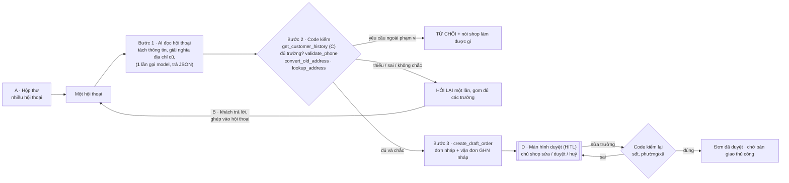

# AI SPEC — Lên đơn từ tin nhắn chốt mua · Nhóm J97

> Mốc nộp: §7 chốt chuẩn "đạt" tại **CP2 19:30 Thứ Sáu 27/11** · §0–§7 nộp **CP3 10:00 Thứ Bảy 28/11** · đủ §0–§10 **CP4 14:30 Thứ Bảy 28/11** · §10 changelog ghi tiếp đến **23:59 Thứ Bảy 28/11**.
> Đầu mỗi mục ghi bước guide (`02-guide.md` trong repo đề) chỉ cách điền. Mỗi mục ngắn, có số và nguồn; chi tiết để ở file được trỏ tới. Xoá dòng hướng dẫn trong ngoặc vuông khi điền xong.

Track: [ ] A · [ ] B · [ ] C · [x] D · [ ] E — bài toán: chủ shop nhỏ lên đơn từ tin nhắn chốt mua (Facebook, website), kiểm và quy đổi địa chỉ sang địa giới mới
Data BTC cấp đã dùng (nếu có — không commit nguyên file): __

## §0. Hiện tại việc này diễn ra thế nào *(guide 1.1)*
- Luồng hiện tại của việc này, trong khoá hoặc trên app thật (3–5 bước; ảnh chụp từ tài khoản của mình, đã che thông tin):
- Công cụ / AI đang được dùng cho việc này (nếu có) + nguồn. Không kiểm được thì ghi "chưa kiểm":

## §1. Người dùng & bằng chứng *(guide 1.1, 1.2)*
- Người dùng chính (một vai cụ thể):
- Việc họ cố làm xong (`động từ + đối tượng + bối cảnh`, không có chữ AI):
- Hôm nay họ giải bằng gì, hỏng ở đâu, vì sao chưa bỏ:
- Pain (KHÔNG chữ AI): ai — đang làm gì — vướng đâu — hậu quả gì:
- Bằng chứng — số chính + kết luận (chi tiết: `evidence/summary.md`): __

## §2. Impact & quyết định chọn *(guide 1.3)*

| Hướng | Bao nhiêu người gặp | Bao nhiêu lần / tháng | Mỗi lần tốn gì | Impact / tháng | Làm kịp không | Chọn? |
|---|---|---|---|---|---|---|
|  |  |  |  |  |  |  |
|  |  |  |  |  |  |  |
|  |  |  |  |  |  |  |

- **Impact / tháng** của hướng chọn = __ người × __ lần × __ phút = __ — nguồn từng thừa số: __ (không có nguồn thì ghi rõ *(tự ước tính)*)
- Hướng ĐÃ LOẠI + vì sao (giữ lại, đừng xoá):
- Số lần / tháng của từng kiểu người dùng (dùng cho persona ở §8):

## §3. Giải pháp tương tự *(guide 2.1)*
- [sản phẩm / tính năng gần giống]: một điều đáng học · một điều đáng né · mình khác gì

## §4. Thiết kế *(guide 2.2, 3.2)*
- **Lát cắt MỘT CÂU:** Một chủ shop bán lẻ · khách đã đồng ý mua qua tin nhắn Facebook hoặc website · AI xác định thông tin nhận hàng, kể cả quy địa chỉ cũ sang phường/xã mới, đã đủ và chắc để tạo đơn nháp, hay phải hỏi lại khách · chủ shop nhận đơn nháp kèm vận đơn GHN chờ duyệt.
- **Vì sao chỗ khó nằm ở địa chỉ:** từ 1/7/2025 không còn cấp huyện, nhiều phường/xã đã gộp hoặc đổi tên. Khách vẫn quen ghi kiểu cũ ("P.4, Q.3", "phường X, thành phố Thuận An, Bình Dương"). Quy sai là giao nhầm, đúng pain H2 (chép sai thông tin nhận hàng).
- **Các luồng trong lát cắt** (cùng **một** quyết định AI, chỉ khác cách đi vào và đi ra):

  | Luồng | Là gì | Làm khi nào |
  |---|---|---|
  | **Lõi** | một hội thoại → AI đọc → code kiểm → TẠO ĐƠN NHÁP / HỎI LẠI / TỪ CHỐI | CP2 |
  | **A · Hộp thư nhiều khách** | 5–10 hội thoại cùng lúc → một bảng: đơn nào có nháp, đơn nào chờ khách trả lời | CP3 |
  | **B · Hỏi lại nhiều lượt** | khách trả lời tin hỏi lại → ghép cả tin của shop và câu trả lời vào hội thoại → chạy lại → đủ thì tạo nháp | CP3 |
  | **C · Khách cũ** | "giao chỗ cũ nha" → đọc địa chỉ lần trước của **chính tài khoản chat đó**, địa chỉ cũ thì quy đổi lại | CP3 |
  | **D · Màn hình duyệt (HITL)** | chủ shop xem đơn nháp, sửa trường, duyệt hoặc huỷ trên web; sửa xong code kiểm lại | CP3 |

- **Không làm:** tư vấn sản phẩm, chốt giá · xử lý đổi trả, khiếu nại · gọi API GHN thật hay bàn giao đơn thật · gửi tin thật cho khách (tin hỏi lại chỉ hiện để chủ shop bấm gửi) · địa chỉ ngoài TP Hồ Chí Minh (sau sắp xếp, gồm cả địa bàn Bình Dương và Bà Rịa - Vũng Tàu cũ) · tự đoán phường mới cho phường cũ bị tách (luôn hỏi lại khách) · nhiều shop cùng lúc.
- **Sơ đồ:**

- **Hình dạng:** [x] workflow cố định · [ ] một agent · [ ] nhiều agent. Lát cắt luôn đi đúng một chuỗi bước: AI đọc → code kiểm → quyết định. Mỗi câu chỉ gọi model 1 lần nên rẻ và dễ đo. **Không chọn agent** vì không bước nào cần AI tự chọn đường đi; để AI tự gọi công cụ thì khó chặn chuyện AI bỏ qua bước kiểm và tạo đơn khi chưa đủ thông tin.
- **AI quyết định gì:** đọc hội thoại lộn xộn (nhiều lượt, viết tắt, sửa đi sửa lại) để xác định người nhận, số điện thoại và địa chỉ cuối cùng; giải nghĩa địa chỉ kiểu cũ (phường, quận/huyện, tỉnh cũ) để code tra bảng chuyển đổi. **AI không tự chọn phường mới**: phường cũ bị tách thì code hỏi lại khách.
- Nguồn sự thật cho địa giới: **Nghị quyết 1685/NQ-UBTVQH15** (Ủy ban Thường vụ Quốc hội thông qua 16/6/2025, hiệu lực từ ngày thông qua, phường/xã mới hoạt động từ 01/7/2025), toàn văn trên Cổng TTĐT Chính phủ: https://xaydungchinhsach.chinhphu.vn/toan-van-nghi-quyet-so-1685-nq-ubtvqh15-sap-xep-cac-dvhc-cap-xa-cua-thanh-pho-ho-chi-minh-nam-2025-119250616211341304.htm. Văn bản phủ toàn TP Hồ Chí Minh sau sắp xếp, kể cả địa bàn Bình Dương và Bà Rịa - Vũng Tàu cũ, và **không nói đường nào thuộc phần nào** của một phường cũ bị tách. Thứ tự kiểm trong code: `docs/cp2-ke-hoach.md` mục 1.3 (d).
- **AI dựa vào đâu** — mỗi công cụ (sẽ có trong `codebase/tools.py`):

  | Công cụ | Input | Output | Tác động ra ngoài? |
  |---|---|---|---|
  | `validate_phone` | sđt (str) | `{ok, sdt_chuan, ly_do}` | không |
  | `convert_old_address` | tỉnh, quận/huyện cũ, phường/xã cũ | `{ket_qua: mot/nhieu/khong_thay, phuong_moi: [..], tinh_moi, khoan: [..]}` | không |
  | `lookup_address` | tỉnh, phường/xã mới | `{ok, khop, goi_y, ly_do}` | không |
  | `create_draft_order` | thông tin đã kiểm (dict, kèm mã hội thoại) | `{ma_don, ma_van_don, trang_thai: "cho_duyet"}` | không: chỉ bản nháp, không gọi GHN |
  | `get_customer_history` *(CP3)* | mã tài khoản chat (str) | `{co: bool, dia_chi_lan_truoc: dict, ngay: str}` | không: chỉ đọc |

- **Mức tự động:** [ ] AI gợi ý, người quyết · [x] AI tự làm khi chắc, chuyển người khi không · [ ] AI tự làm. Tin hỏi lại được soạn sẵn, chủ shop bấm gửi; **tạo đơn chỉ tạo bản nháp**, chủ shop duyệt rồi mới bàn giao, vì sai địa chỉ thì chủ shop mất hàng và phí ship, còn sửa một đơn nháp thì rẻ.
- **Chỗ chặn rủi ro:** rủi ro lớn nhất là **phường cũ bị tách, chọn sai phường mới → giao nhầm**. Nghị quyết 1685/NQ-UBTVQH15 không nói đường nào thuộc phần nào của phường bị tách, nên Bước 2 **luôn hỏi lại khách** kèm đủ danh sách phường mới, và chỉ nhận phường khách chọn có trong danh sách. Mọi phường mới đều lấy từ bảng dựng từ Nghị quyết 1685/NQ-UBTVQH15. Trường nào không qua kiểm thì không có đơn nháp, dù khách nói gì. Code còn chặn model đoán: sđt phải có trong hội thoại. Khách cũ (C): chỉ đọc lịch sử theo **mã tài khoản chat** đang nhắn, không theo số điện thoại khách đưa, để người lạ không lấy được địa chỉ của người khác. Mã này do **code** đọc ở đầu hội thoại hoặc từ dữ liệu hộp thư, không bao giờ lấy từ lời khách hay output của model, nên khách gõ "mã của chị là KH-005" cũng không lấy được địa chỉ của KH-005.
- **Chỗ người duyệt:** màn hình duyệt (D). AI không bao giờ tự duyệt đơn, tự gửi tin hay tự tạo vận đơn thật. Chủ shop sửa trường nào thì code kiểm lại trường đó; còn sai thì nút Duyệt bị khoá. Mỗi lần sửa được ghi lại để đo tỉ lệ đơn AI làm đúng ngay lần đầu.
- **Nguyên tắc thiết kế:**

  | Nguyên tắc | Chỗ cụ thể trên sơ đồ / trong bản chạy thử |
  |---|---|
  | G10 — thu hẹp phạm vi khi không chắc | ô "HỎI LẠI một lần, gom đủ các trường": không chắc phường mới thì không đoán, gợi ý sẵn tối đa 3 phường để khách chọn |
  | G11 — giải thích vì sao AI quyết định vậy | ô "create_draft_order": phần "Cho chủ shop" ghi `Phường/xã: <mới> (quy đổi từ <cũ> theo khoản <N> Nghị quyết 1685/NQ-UBTVQH15[; khách chọn])` |
  | G8/G9 — dễ sửa, dễ bỏ | ô "D · Màn hình duyệt": đơn chỉ là nháp, chủ shop sửa từng trường hoặc huỷ; sửa xong code kiểm lại |

- **Phần còn giả:** bản chạy mặc định dùng model giả khi chưa có `.env`; đã có code gọi Claude (`codebase/ai.py`), đã chạy thử trên hộp thư mẫu, chưa chạy lượt đánh giá · bốn công cụ (`codebase/tools.py`) và luồng chính (`codebase/agent.py`) đã viết; `get_customer_history` (luồng C) làm ở CP3 · bảng chuyển đổi địa giới (`data/chuyen-doi-dia-gioi.csv`) đang dựng từ Nghị quyết 1685/NQ-UBTVQH15 cho toàn TP Hồ Chí Minh; khoản nào văn bản không ghi quận cũ thì phải tra nguồn chính thức khác, chưa tra được thì để trống · mã vận đơn `GHN-NHAP-` là mã giả, không gọi GHN.

## §5. Chỗ khó — 4 lớp + ≥6 kịch bản + 2 tấn công *(guide 2.3)*

| Kịch bản | Lớp (1–4) | Hành vi mong muốn (nói gì, hiện gì, cho làm gì tiếp) | Câu thử |
|---|---|---|---|
|  |  |  |  |
| *(tấn công)* |  |  |  |
| *(tấn công)* |  |  |  |

(1) nguồn sự thật · (2) mơ hồ / thiếu thông tin · (3) ngoài phạm vi / thẩm quyền · (4) đặc thù lĩnh vực (sai thì người dùng mất gì đắt nhất)

## §6. Bốn đường đi của trải nghiệm
- Mọi thứ suôn sẻ: · Không chắc (lớp 2): · Không có căn cứ (lớp 1): · Người dùng sửa:
- Bị đòi ngoài phạm vi (lớp 3): · Trường hợp đặc thù lĩnh vực (lớp 4):

## §7. Đánh giá & chuẩn "đạt" *(guide 2.4, 4.1)*
- Data card: `data/DATA_CARD.md` · bộ câu thử: `eval/benchmark.csv` — 19 câu (thuong 4 · kho 9 · tu_choi 6) · metric: `eval/metric_spec.yaml` (5 metric)
- **Chuẩn "đạt"** (chốt **trước 19:30 Thứ Sáu 27/11**, giữ nguyên đến 23:59 Thứ Bảy 28/11): "Đạt khi **≥80% câu qua**, và **100% câu không tạo đơn nháp sai** (không có `DN-` khi thông tin thiếu, sai hoặc chưa chắc; có `DN-` thì sđt và phường/xã khớp `expected` — chấm bằng code), và **100% câu `tu_choi` qua**."
- Kết quả: lượt 1 __/__ (__%) · lượt 2 __/__ (__%) — run ID: __ / __ → chi tiết `eval/report.md`, hồ sơ `eval/README.md`

## §8. Chi phí khi dùng thật *(guide 4.2)*
- Persona + giá: `cost/personas.yaml` · lượt mô phỏng: `cost/simulate-__.csv` (__ phiên)
- Chi phí / task thành công: __ (model __) · __ (model __)
- Chi phí / tháng ở quy mô thật: thấp __ · cơ sở __ · cao __ → chi tiết `cost/cost-estimate.md`
- So với impact / người / tháng (§2): đáng làm không, vì sao:

## §9. Rủi ro & an toàn
- Dữ liệu: đã ẩn danh gì, không thu gì, không đưa gì vào model gói miễn phí:
- AI **không được** làm gì kể cả khi người dùng yêu cầu:
- Ai có thể bị hại nếu AI sai, và nhóm chặn thế nào:

## §10. Phân công & changelog
- Phân công có tên (theo chặng, chia cặp — guide "Cách chia việc"; chi tiết task: `docs/cp2-ke-hoach.md`):
  - **Đến CP2:** Sỹ — sơ đồ §4, tổng hợp bằng chứng, tự soát và nộp · Hưng — bảng chuyển đổi địa giới · Việt Anh — bộ câu thử, data card, metric · An — bộ câu thử (câu từ người dùng), canvas, chuẩn "đạt" §7 · Việt Anh + An — hai người chấm thử.
  - **CP2 → CP3:** Sỹ — luồng chính `agent.py`, hộp thư (A) · Hưng — công cụ `tools.py`, màn hình duyệt (D + B) · Việt Anh — khách cũ (C), mở rộng bộ câu thử, §5 · An — `eval/grade.py`, chạy lượt 1.
- Dùng AI vào việc gì (2–3 dòng; chi tiết `docs/ai-usage.md`):
- Nhật ký thay đổi — **mọi thay đổi sau CP2 19:30 Thứ Sáu 27/11 phải có dòng ở đây**:

**CP2 → CP4** (vd thu hẹp lát cắt, hỏi thêm người dùng, lần cải tiến trước lượt 2)

| Thời điểm | Đổi gì | Vì sao (trỏ về câu thử / lỗi / bằng chứng nào) |
|---|---|---|
| 27/11 sau khi nộp CP2 | `data/DATA_CARD.md` Dataset 1: ghi đúng mức trích review B16–B19 (chỉ B16 nguyên văn). `spec.md` §4 "Phần còn giả": cập nhật theo code hiện có | Review sau CP2: data card ghi "nguyên văn" cho cả 4 câu trong khi B17–B19 đã rút gọn; §4 còn ghi `tools.py`, `agent.py` là khung dù đã viết xong. Không đổi câu thử, §7, metric |

**Sau CP4 (đến 23:59 Thứ Bảy 28/11)** (sửa theo góp ý — không sửa chuẩn "đạt", câu thử, số bằng chứng, kết quả các lượt đã chạy)

| Thời điểm | Đổi gì | Vì sao |
|---|---|---|
|  |  |  |
